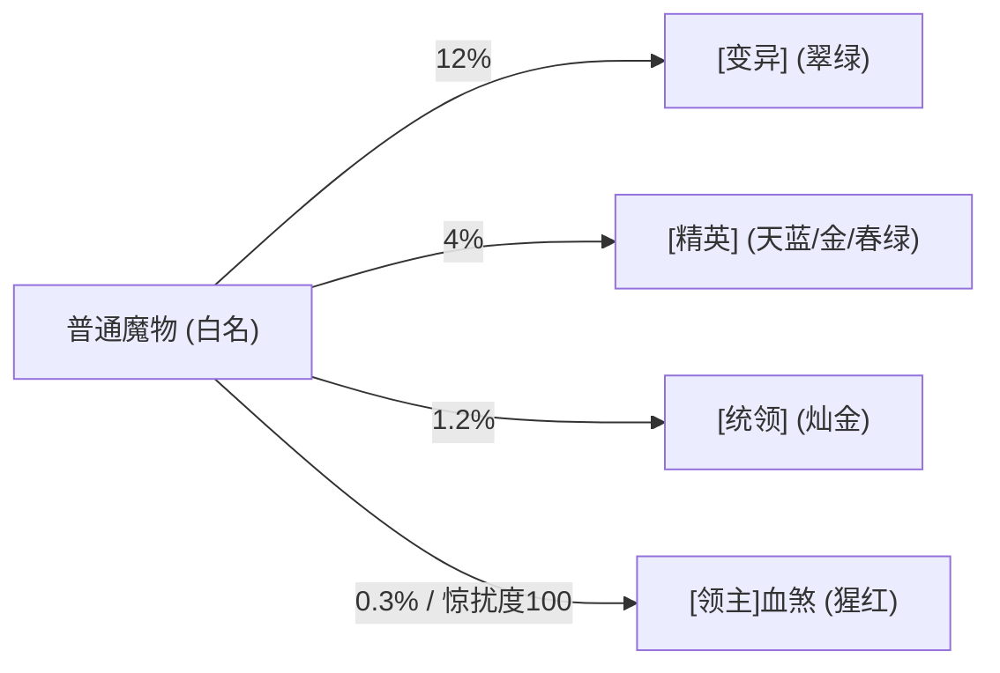

# 玛法独行版 · 核心扩展玩法与功能速查手册

本文档汇总了本项目基于 Crystal Mir2 引擎魔改落地的所有独行扩展功能、特色奇物、怪物生态、装备品质与便民优化，供玩家与开发者快速查阅。

---

## 一、 两大随身核心奇物（创建角色即送 / 永久 0 负重 / 死亡不掉落）

新角色初次进入游戏，背包会自动发放两件独行专属永久奇物（若不慎遗失，重新登录或与主城军需官对话即可免费补发）。

### 1. ⛺ 玛法行军帐（背包图标：3771 行囊帐卷）
* **地宫野外实地扎营**：
  * 在野外、矿洞、地宫等非安全区双击行军帐，消耗 `2,000` 金币即可在身边**实地搭起一顶可视化的行军大帐**（金色名字 `{角色名}的行军帐`）。
  * 真实 NPC 实体，玩家与同伴可随时点击帐篷呼出交互面板。
  * 换地重新扎营时，旧地点的帐篷会自动收起并迁移至新点位。
  * **终极 Boss 房禁营保护**：石墓七层、赤月魔穴、恶魔祭坛、祖玛教主之家等终极 Boss 区域严禁扎营，保留跑图挑战。
* **安全区一键携英雄返场**：
  * 地宫扎营后使用回城卷回城补给、修理装备。
  * 在各大主城安全区再次双击行军帐，即可**携 Hero 英雄一键直飞传回营地帐篷旁**，免去长途反复跑图烦恼。

### 2. 📖 玛法猎魔手札（背包图标：2120 羊皮古籍）
* **4×4 隔空范围自动拾取**：
  * 双击手札或点击选项，可在三档模式间无缝循环切换：
    1. **4×4 智能极品拾取（推荐）**：自动吸取周围 4 格内的金币、药水、技能书、纯度≥10 的矿石、以及 `【精良】` 及以上四阶品质装备；自动过滤肉块、低纯度废矿与普通低级白装。
    2. **4×4 全部拾取**：吸取 4 格内一切可见掉落物（受包袱负重保护）。
    3. **关闭自动拾取**：还原纯手动走步拾取。
  * **存档独立保障**：拾取状态严格由服务端独立 JSON 存档管理，下线即时存盘，跨设备登录不失效。
* **本层猎魔感知罗盘（全图怪物雷达）**：
  * 实时感应并显示当前地图的**杀戮惊扰度**（`0~100`）。
  * 实时扫描并列出本层所有存活的高级魔物：精确显示名字、阶级、坐标、八方罗盘方位（如东南、西北）与直线步数。
* **玛法猎魔图鉴（8 大章节永久属性积累）**：
  * 涵盖比奇荒野、废矿尸群、死亡山谷、沃玛神殿、石墓烈焰、祖玛阁楼、赤月魔穴、神龙雪域 8 大章节。
  * 击杀对应地图怪物累积斩杀进度，每达成一章即为角色永久激活攻魔道、双防与掉宝率加成。

---

## 二、 操作手感与便民优化（找回盛大 1.76 丝滑质感）

| 优化特性 | 改造说明 | 实际效果 |
| :--- | :--- | :--- |
| **无助跑瞬时起跑** | 移除静止站立时的起跑预热步与血量限制；服务端防作弊同步放行首帧跑步 | 角色停下后按右键**起跑零延迟**，不再需要先走一步，告别起跑卡顿与原地拉回 |
| **近距离右键起跑** | 放宽鼠标与角色的起跑距离门槛 | 鼠标位于身旁 1~2 格时右键直接起跑，仅在点击脚下时判定为走步 |
| **遇障自动滑步 & 降级** | 跑步前方两格遇障时，自动向左右 ±45° 扇区探测；若均受阻则自动降为走步脱困 | 森林树木与狭窄地道**自动顺滑绕障奔跑**，彻底解决跑动中迎面撞树/怪原地卡死 |
| **免 Shift 攻击 & 智能追击** | F12 / O 设置面板提供“免Shift攻击”开关；战士刺杀剑术智能识别 | 鼠标直接悬停怪物即自动挥刀；开启刺杀时 2 格距离自动隔位刺杀；远距离跑近、近距离贴身 |
| **动作预输入与吃药解耦** | 动作后 30% 窗口开放指令预输入缓存；药水使用冷却降为 `200ms` 且脱离普通动作锁 | 跑步和挥刀动作未完全结束时按技能不吞键；激烈战斗中吃药不卡动作、不吞药水 |
| **4×4 拾取严格负重保护** | F12 / O 设置面板新增勾选；登录与点击实时双向同步服务端拦截 | 拾取前严格校验包袱承重，**达到负重上限前自动停止吸取装备**，绝不超重变走步 |
| **地面显名与四色品质显色** | 地面物品名称常驻显示，极品装备根据品质赋予四色高亮；显名显血 | 掉落一目了然，无需按住 Alt 摸索，极品掉落一眼辨认 |
| **盛大 1.76 石雕底栏 HUD** | 挂载独立 `Prguse176.lib` 图库，1366×768 宽屏居中对齐盛大 800×251 石雕主框 | 完美复原**左侧日月同辉红蓝大血球、经典经验条与右侧石雕中文圆钮**，支持热切换 |

---

## 三、 四阶野外魔物生态与动态战役机制

野外与地宫怪物在刷新时有几率发生变异，赋予专属颜色、血量倍率、丰厚掉落与独有 AI。

### 1. 四阶魔物详情

| 阶级 | 头顶前缀与标识 | 出现概率 | 生命倍率 | 经验倍率 | 掉宝率提升 | 核心产出与装备保底 |
| :--- | :--- | :--- | :--- | :--- | :--- | :--- |
| **一阶** | 翠绿 `[变异]` | 12% | **1.8x** | **2.5x** | +20% | 额外必爆保底赏金金币，掉落装备保底赋能 **`【精良】`** |
| **二阶** | 天蓝/金色/春绿 `[精英]` | 4% | **3.0x~4.2x** | **5.0x** | +40% | 掉落装备保底赋能 **`【稀有】`**；根据词缀带专属掉落： • `[精英・富饶]`：必爆 2 堆丰厚金币 • `[精英・坚韧]`：必爆 1~2 块纯度 15~22 黑铁矿 • `[精英・狂暴]`：攻移速暴增，经验更高 |
| **三阶** | 灿金 `[统领]` | 1.2% | **5.0x** | **9.0x** | +60% | 极高概率掉落高级祖玛/沃玛装备，装备保底赋能 **`【史诗】`** |
| **四阶** | 猩红 `[领主]血煞...` | 0.3% (或惊扰度满) | **9.0x** | **15.0x** | +100% | 必爆 2~3 堆高额领主赏金金币，装备保底赋能 **`【神话・传世】`** |

### 2. 地图杀戮惊扰度机制（Map Heat `0~100`）
* 玩家在洞穴与野外击杀怪物会累积当前地图的杀戮惊扰度（击杀普通怪 `+1`、变异怪 `+2`、精英/统领 `+5`）。
* **达到 50 点**：全图红字震动警报，立刻在玩家身旁就近强刷一头 `[精英]` 怪物！
* **达到 100 点**：惊扰度清零，并在身旁直接降临一头极为凶猛的猩红 `[领主]血煞` 霸主！

### 3. 领主两段式动态战役 AI
* **50% 血量（卫队召集）**：领主怒吼并在身边召唤 2 只同族 `[变异]` 亲卫护驾，打乱输出节奏。
* **20% 血量（血怒狂暴）**：领主进入狂暴状态，攻速大幅提升、双攻暴增 25%，**同时锁死自身自然回血（`CanRegen = false`）**，杜绝单人残局伤害不足被怪物回满血的绝望感。

---

## 四、 四阶装备品质体系与词条重铸

击杀变异魔物或通过神匠重铸掉落的装备，带有醒目的四色品质前缀与专属点数：

| 品质等级 | 颜色显示 | 基础属性增幅 | 特殊词条与概率 | 说明 |
| :--- | :--- | :--- | :--- | :--- |
| **🟢【精良】** | 翠绿色 | **+1 ~ +2** 点主属性 | 纯基础属性提升 | 前期开荒主力过渡装备 |
| **🔵【稀有】** | 天蓝色 | **+2 ~ +4** 点主属性 | **15%** 概率附带幸运、命中、敏捷、吸血、暴击 | 性价比极高的实用极品 |
| **🟡【史诗】** | 灿金色 | **+3 ~ +5** 点主属性 | **35%** 概率附带高级特殊词条 | 强力毕业级神装 |
| **🔴【神话・传世】** | 猩红色 | **+3 ~ +6** 点主属性 | **100% 必带** 顶级特殊词条与额外强化 | 极为罕见的传世孤品 |

> **保底与防通胀机制**：
> - **词条点数下限保底**：掉落与重铸严格受品质档位分值下限约束（【稀有】必定 $\ge 3$ 点分值，【史诗】必定 $\ge 5$ 点分值），绝不出现品质与属性名不副实的情况。
> - **单怪掉落数量上限**：领主最多掉落 3 件、统领最多 2 件、变异最多 1 件，且仅首件装备享受专属阶级词条重铸，防止低级怪物爆满地红装导致经济崩盘。

---

## 五、 城镇特色单人后勤 NPC 服务

### 1. 全商人跨店通卖（行商破壁机制）
* **彻底解除指定商店出售限制**：在任何提供买卖面板的商人处（药店、首饰店、防具店、武器店、杂货铺），均可一键出售背包里所有可卖物品，无需再满城跑图分类卖装。
* **价格结算规则**：
  * **本行商品**：按 **100%** 原价（`Price() / 2`）正常结算。
  * **非本行商品（跨店代收）**：仅收取 **10%** 跨行手续费，按 **90%** 正常价格收购。

### 2. 【玛法军需官】（比奇安全区 `328,265` / 盟重安全区 `333,325`）
* **【一键安全回收杂物】（`@Solo_QuickSell`）**：
  * 批量将背包内所有低级白板装备折算为金币。
  * **100% 智能跳过并保护**：所有 `【精良】` 及以上四阶品质装备、任何带极品点数/特殊词条/插槽的装备、以及沃玛/祖玛/赤月/裁决/骨玉/龙纹/井中月等所有知名品牌装备，绝不误卖。
* **【主将+英雄全身特修】（`@Solo_QuickRepair`）**：
  * 一次点击同时修复主号与英雄身上穿戴的所有受损装备，持久直接回满且**永不掉持久上限**。

### 3. 【盟重神匠】（盟重土城安全区 `326,325`）
* **【同名装备三合一重铸】（`@Solo_Reforge3`）**：
  * 玩家打到多余重复的祖玛、赤月或沃玛装备时，只需在背包备齐 **3 件同名装备 + 50,000 金币** 即可重铸。
  * 自动挑选并消耗背包中附加属性最低的 3 件，重新合成 1 件全新极品：
    * **82%** 概率赋能为 `【稀有】` 或 `【史诗】`。
    * **18% 欧皇觉醒**：直接觉醒为大红色彩的 **`【神话・传世】`** 孤品神装！

---

## 六、 基础版本设定与游戏节奏

* **五大职业全开放**：战士、法师、道士、刺客（Assassin）、弓箭手（Archer）全部可用，配备专属技能与觉醒系统。
* **Hero 英雄副将（22 级招募）**：
  * 达到 22 级即可招募专属英雄，提供 25 种职业流派组合。
  * **双人经验协同**：主号与英雄同屏作战时，主将享受 75%、英雄享受 45%，合计享受 **120%** 的经验加成。
  * 支持英雄快速召回、守护与脱战管理。
* **慢节奏单人长效数值倍率**：
  * **经验倍率：2 倍**（配合动态多段衰减，前期节奏适中，中后期长期开荒）。
  * **装备掉落：1 倍**（维持药水、卷轴与中高级名牌装备稀缺度与保值性）。
  * **金币掉落：3 倍**（平衡行军扎营、英雄饲料、特修与神匠重铸开销）。
  * **技能倍率：6 倍**（减轻主号加英雄双份技能树练级肝度）。
* **死亡与惩罚保护**：
  * `DropEquippedItems = False`：死亡仅会掉落背包部分杂物，**穿戴在身上的高强化、觉醒与极品装备绝对不爆**，安心挑战高难度地宫。
* **全图真实碰撞**：
  * 开启全图物理障碍与人物碰撞（`SafeZoneWalkThrough = False`），还原经典人挤人、卡位抗怪的硬核战术手感。
